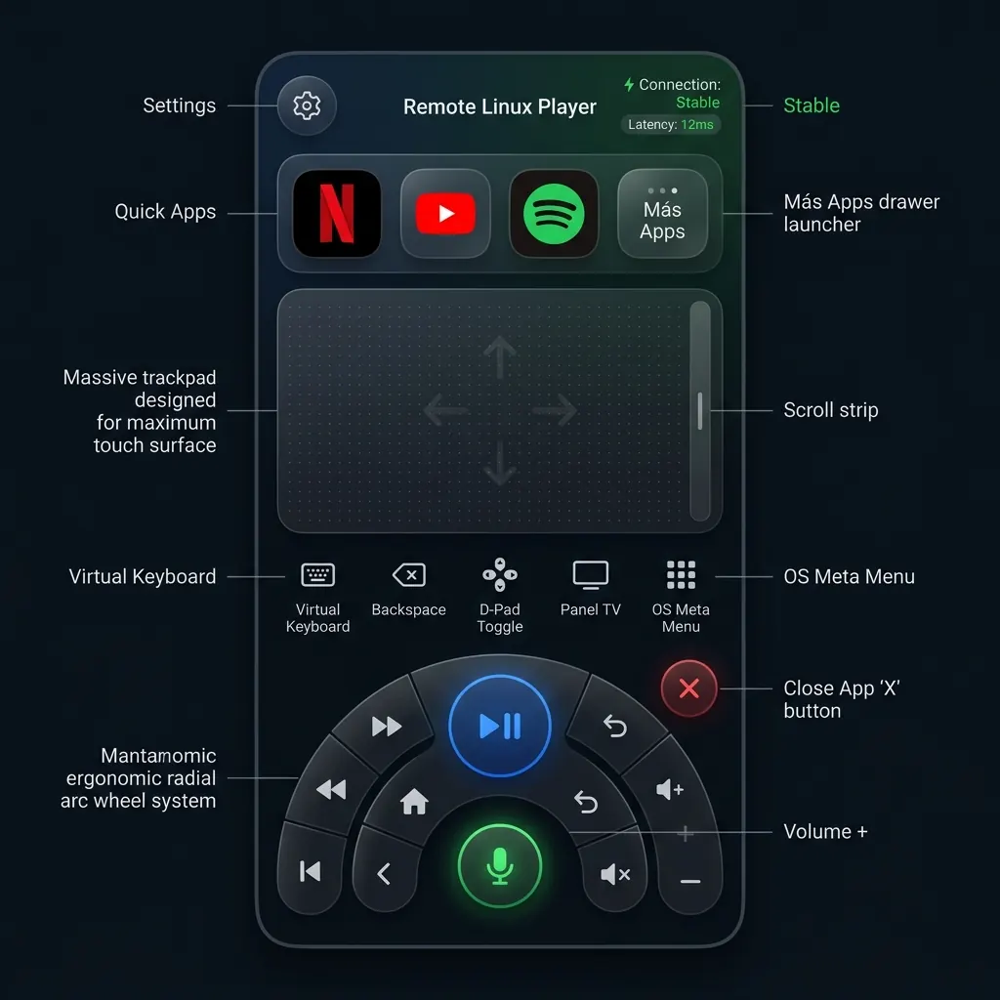
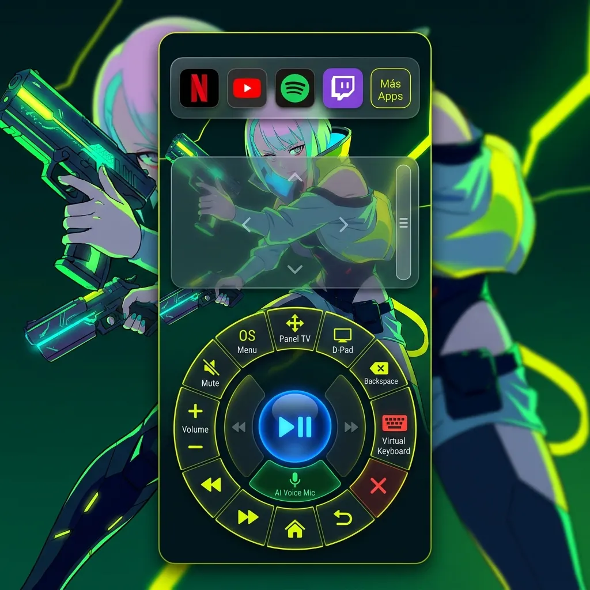
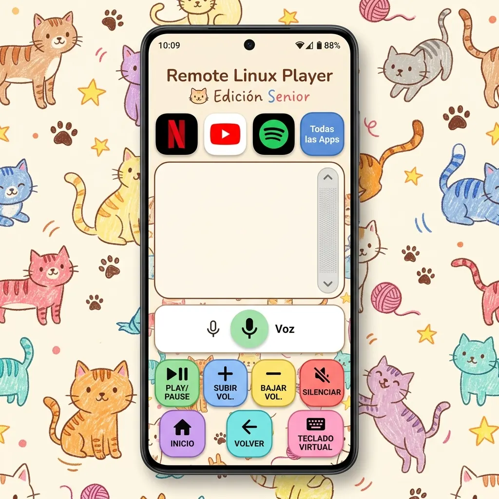
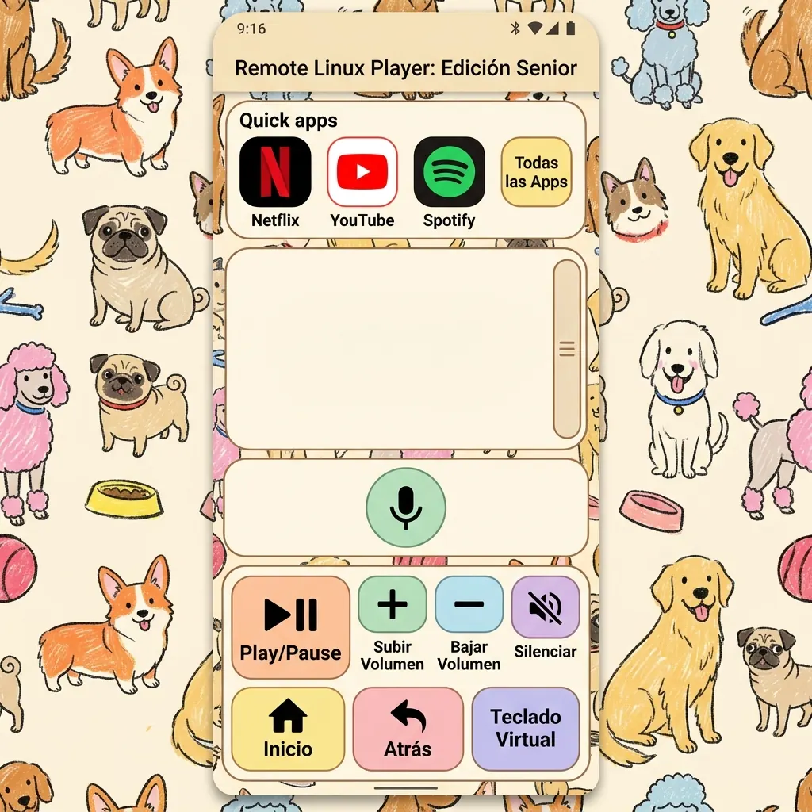

# Propuestas de Diseño UI — Remote Linux Player (Mobile PWA)

Este documento reúne las alternativas conceptuales de interfaz de usuario en formato vertical **9:16** para la aplicación móvil **Remote Linux Player**.

---

## Alternativa 1: Diseños Radiales Ergonómicos (Radial Cyber-Luxe)

Una reinvención de la botonera clásica basada en un **disco radial ergonómico** inferior, optimizado para el alcance natural del pulgar en smartphones.

### Características clave:
* **Disposición Radial Ergonómica**: Botonera dispuesta en arcos concéntricos rodeando el control de reproducción.
* **Touchpad 100% Despejado**: Superficie táctil limpia en la zona media con textura de puntos y barra de scroll lateral.
* **Micrófono de Voz por IA Reubicado**: Botón circular neón posicionado en el centro del cluster inferior de controles para un alcance cómodo.
* **Módulo de Cajonera ("Más Apps")**: Isla flotante superior con accesos a apps principales y cajonera completa.

---

## Alternativa 2: Edgerunners Cyberpunk Edition (Amarillo/Verde Neón)

Una propuesta inspirada en la estética gráfica neón de **Cyberpunk: Edgerunners** en tonos amarillo eléctrico y verde ácido, combinando la ilustración anime de cuerpo entero con la **distribución radial ergonómica**.

### Características clave:
* **Ilustración Anime Edgerunners**: Chica anime de cuerpo entero con atuendo y arma futurista en postura de acción.
* **Paleta Neón Amarillo & Verde Ácido**: Alto impacto visual neofuturista sobre fondo oscuro.
* **Botonera Radial Ergonómica**: Mantiene la rueda radial inferior con el micrófono en la zona central y el touchpad totalmente despejado arriba.

---

## Alternativa 3: Cozy Cat Senior Accessible Edition (Gatitos Pasteles)

Una skin accesible en formato vertical **9:16**, pensada para adultos mayores o personas sin conocimientos técnicos avanzados, con fondo continuo de gatitos a crayón, touchpad despejado y botones extra grandes.

### Características clave:
* **Fondo Integrado de Gatitos**: Ilustración a crayón de gatitos sobre tono crema.
* **Touchpad 100% Despejado & Micrófono Independiente**: Zona táctil libre en el centro con el botón de voz IA posicionado abajo.
* **Fila Superior de Apps Frecuentes**: Accesos a apps más usadas y botón para desplegar "Todas las Apps".

---

## Alternativa 4: Cozy Dog Senior Accessible Edition (Perritos Pasteles)

La versión hermana de accesibilidad temática, reemplazando las ilustraciones por **perritos adorables dibujados a crayón** (Corgis, Pugs, Golden Retrievers) sobre fondo crema con la misma interfaz simplificada.

### Características clave:
* **Ilustraciones de Perritos a Crayón**: Arte amigable de perritos de varias razas en estilo dibujo infantil/crayón sobre fondo beige cálido.
* **Misma Estructura de Accesibilidad**: Touchpad despejado, fila superior de apps más frecuentes + cajonera, micrófono independiente y botones pastel extra grandes de alto contraste.

---

> Documento ORIGINAL del dueno (2026-07-24), conservado tal cual salvo los
> enlaces de imagen, que apuntaban a una carpeta temporal de Gemini y se
> reapuntaron a las copias WebP de este mismo directorio.
> El analisis tecnico y las decisiones viven en PH17 de `.agents/PLAN.md`.
