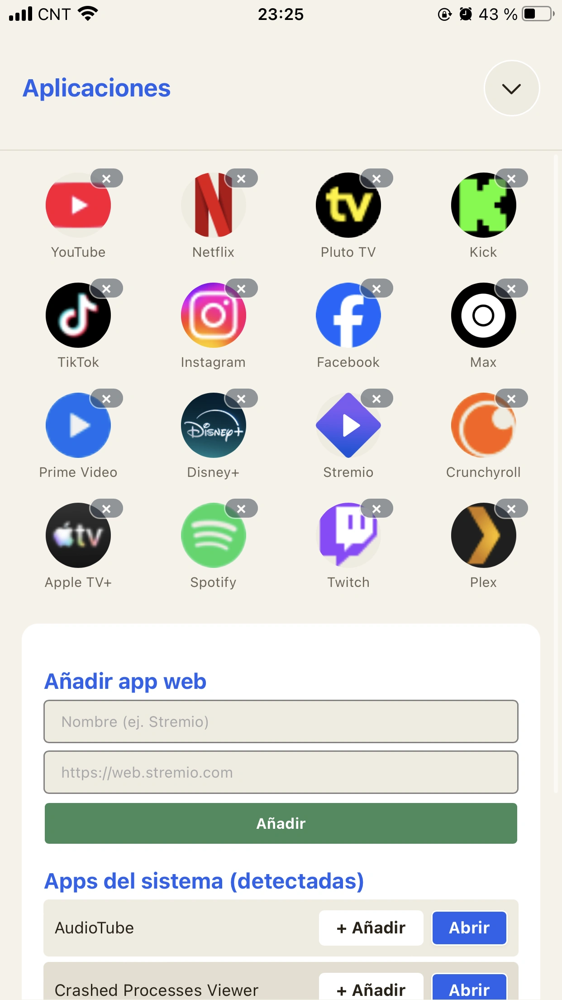
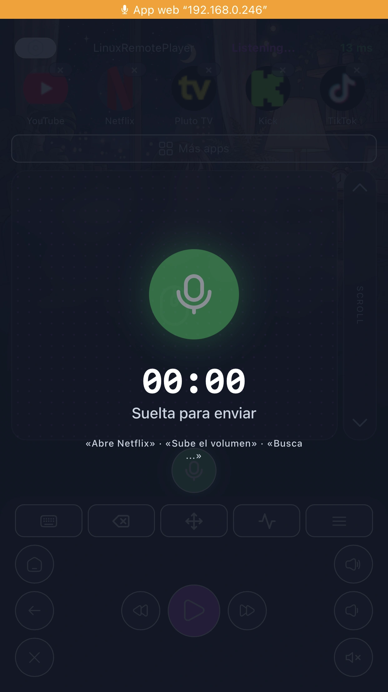

# LinuxRemotePlayer

**Convierte una PC compatible en una Smart TV.** LinuxRemotePlayer ofrece control remoto desde el teléfono: touchpad, teclado, apps de streaming en modo kiosk y control por voz con IA.

A plug & play remote-control ecosystem for Linux HTPCs: a mobile PWA client talking to a local FastAPI backend over secure WebSockets.

🌐 **Website:** [www.linuxremoteplayer.com](https://www.linuxremoteplayer.com)

---

## Screenshots

| The remote | App drawer | Voice command |
| :---: | :---: | :---: |
|  |  |  |

*Real screenshots from the current application. All four themes (Day, Night, Café, Anime) ship free.*

---

## Features

* **Virtual input emulation** — mouse pointer, clicks, scroll, long-press right click, full keyboard bridge and media keys (transport, volume, mute) injected via `uinput`.
* **Streaming apps in kiosk mode** — Netflix, YouTube, Max, Disney+, Spotify, Twitch and any custom web app, launched full-screen in Firefox ESR. Native Linux apps are auto-discovered from `.desktop` entries.
* **Installable PWA** — offline-capable app shell, no address bar, no stores. Network-first service worker keeps clients up to date automatically. *(Nota iOS: iOS hornea las metas del PWA al instalar — tras actualizaciones que toquen manifest o metas apple-*, es necesario reinstalar la app en el teléfono).*
* **Resilient connection** — ping/pong heartbeat, reconnect-on-wake, exponential backoff, and an actionable troubleshooting banner when something is wrong.
* **Self-healing HTTPS** — local two-tier CA (`ca.pem` + leaf certs) regenerated automatically for the current IP and `hostname.local` (mDNS via avahi). Install the CA once on your phone and never see a warning again.
* **Secure pairing** — no unauthenticated mode. A pairing token is auto-provisioned and delivered as a one-tap link at install time.
* **Voice intent engine** *(license-gated)* — speech-to-text plus LLM intent parsing, in Spanish or English. **The HTPC holds no AI provider keys:** it calls our `ai-proxy` Edge Function, which validates licence, device and daily quota server-side before reaching the model provider (Together AI: Whisper-large-v3 + Qwen2.5-7B-Instruct).

---

## Architecture

> **Joining the project?** Two documents, in this order:
> [`docs/ARCHITECTURE.md`](docs/ARCHITECTURE.md) — the shape of the system: component
> responsibilities and boundaries, data flow, dependencies and their failure modes, why the
> non-obvious decisions were made, known limitations, and an honest ledger of what is
> verified and what isn't. Then [`docs/DEVELOPING.md`](docs/DEVELOPING.md) — how to get it
> running, how to make a change safely, and the traps that have cost people time.

```
              +---------------------------+
              |    Mobile PWA client      |
              |  (vanilla JS, offline)    |
              +-------------+-------------+
                            |  WSS + auth frame / REST + token header
                            v
              +-------------+-------------+
              |   FastAPI backend (HTPC)  |
              |       backend/main.py     |
              +------+-------------+------+
                     |             |
        +------------v---+   +-----v------------------+
        | input_emulator |   |      ai_pipeline       |
        | uinput virtual |   | ASR + LLM intent       |
        | mouse/keyboard |   | (via ai-proxy)         |
        +----------------+   +------------------------+
```

---

## Installation

On a Debian 13 stable amd64 minimal PC connected to your TV, install everything with a single command:

```bash
curl -fsSL https://www.linuxremoteplayer.com/install.sh | sudo bash
```

The installer configures the LRP-owned Xorg/Openbox session, Firefox ESR, mDNS, `uinput` permissions, firewall rules and the systemd service. Reboot or re-login once after the first install. Other distributions, GPUs or desktop environments may work accidentally, but are not guaranteed.

The initial certified GPU is an NVIDIA RTX 3060 12 GB using the driver available from the Debian repositories. Other GPUs are not certified.

---

## Licensing & Voice Activation

Touchpad, keyboard, streaming apps, system apps and **all four themes** are free, forever. Only the **Voice Intent Engine** requires a personal licence key ($5, one-time).

> Note on wording: this project is **source-available under the Elastic License 2.0**, not open source. See [License](#license) below.

1. Buy a license from the [Official Website](https://www.linuxremoteplayer.com/).
2. You will receive a code `LRP-XXXX-XXXX-XXXX` instantly in your email.
3. Open the app on your mobile device, navigate to **Ajustes** (gear icon), paste the code under **Clave de licencia**, and tap **Activar**.
4. The microphone row will automatically appear in your app remote!

---

## Operational Scripts

### Updating the App
You can trigger an update directly from the mobile app's **Ajustes** page by clicking **Buscar actualización** then **Actualizar**, or run the script on the HTPC:
```bash
./scripts/update.sh
```

### Uninstalling the App
To completely remove all services, firewall rules, modules, and directories from your system:
```bash
sudo ./scripts/uninstall.sh
```

---

## Pairing your phone

The installer (and every backend start) prints a pairing link:

```
https://<hostname>.local:8000/?token=<token>   or   https://<ip>:8000/?token=<token>
```

1. Open the link in your phone's browser (same WiFi) and accept the certificate once — or install the CA from **Ajustes → Descargar Certificado CA** to trust it permanently.
2. Add the app to your home screen ("Add to Home Screen" / "Instalar app").
3. Open it from the icon. The token is stored in `localStorage` + `IndexedDB`; if the app ever shows *No autorizado*, re-enter the token from `backend/.pairing_token` in **Ajustes**.

---

## Troubleshooting

| Symptom | Check | Fix |
| :--- | :--- | :--- |
| Phone won't connect after a while | `ip -4 addr` — did the HTPC IP change? | Use `https://<hostname>.local:8000` (mDNS) or set a DHCP reservation. |
| TLS errors in the PWA | Open `https://<ip>:8000` in the phone *browser* | Re-accept the cert, or install the CA from `/api/ca` once. |
| "No autorizado" | WS closes with code 1008 | Enter the token from `backend/.pairing_token` in Ajustes. |
| Buttons do nothing | `curl -k https://127.0.0.1:8000/api/debug` | `evdev_available` must be `true`; ensure your user is in the `input` group and reboot. |
| Service down | `systemctl status linuxremoteplayer` | Logs: `journalctl -u linuxremoteplayer -n 100`. |

More detail in the project's internal test plan (`.agents/TESTING.md`).

---

## Configuration

All backend options live in `backend/.env` (see [`backend/.env.example`](backend/.env.example)): voice on/off, ai-proxy URL, pairing token override, log level.

---

## Repository layout

```
├── backend/            FastAPI server: input emulation, kiosk launcher, AI pipeline, licensing
│   ├── main.py         WebSocket + HTTP controllers and endpoints
│   ├── ai_pipeline.py  Thin client of the ai-proxy Edge Function (no provider keys here)
│   ├── input_emulator.py  Virtual mouse / keyboard / gamepad via uinput
│   ├── kiosk.py        Firefox kiosk launcher + window management
│   ├── discovery.py    Native .desktop app discovery
│   ├── audio.py        Volume / mute control (wpctl / pactl)
│   ├── auth.py         Pairing tokens + license verification (grace caching)
│   ├── run.py          HTTPS self-healing, local CA, entrypoint
│   └── requirements.txt
├── frontend/           PWA client (index.html, app.js, sw.js, status.html, CSS, icons, fonts)
├── scripts/            Operational scripts (install / update / uninstall, build_deb, CSS guard)
│   └── dev/            One-shot asset-generation tools (icons, fonts) — not shipped in the .deb
├── supabase/functions/ Edge Functions (ai-proxy, validate-license, stripe-webhook, send-feedback)
├── website/            Marketing pages + install.sh + downloads/ (.deb) + latest.json — deployed on Vercel
├── CHANGELOG.md        Semantic version release log
└── VERSION             Current release version
```

---

## License

Source-available under the [Elastic License 2.0](LICENSE): free to use, copy and
modify; you may not offer it as a managed service, circumvent the license-key
functionality, or remove notices.

Third-party components: [THIRD_PARTY_LICENSES.md](THIRD_PARTY_LICENSES.md).
