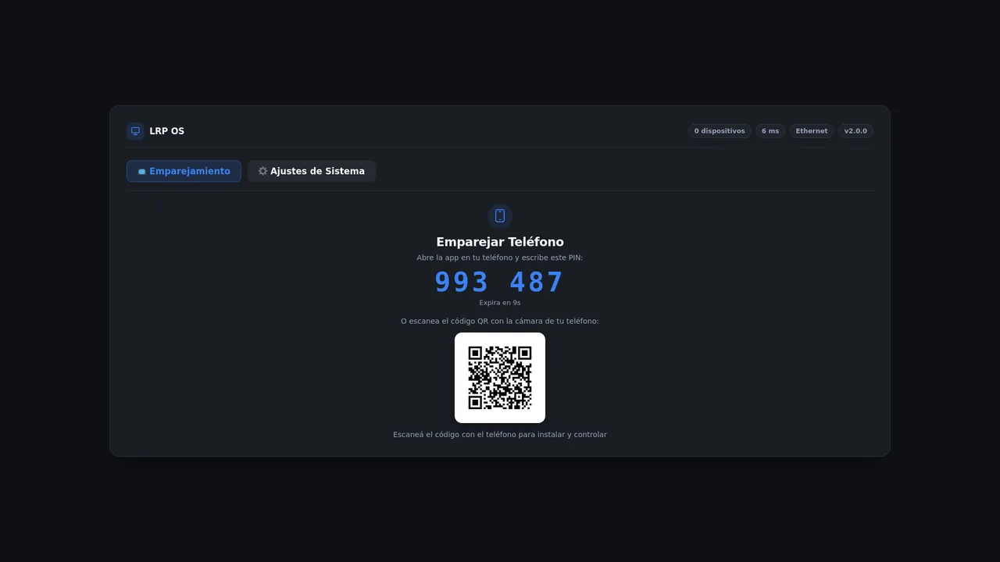
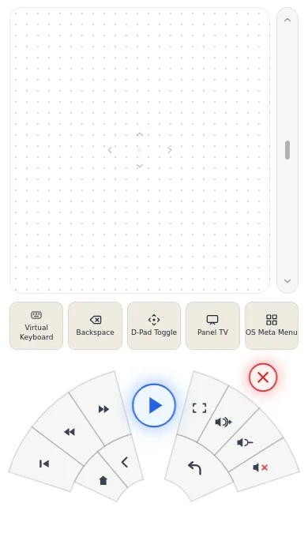

# LRP OS

**English** | [Español](README.es.md)

LRP OS 1.0.1 is a Debian 13 ISO that turns an x86_64 PC into a TV appliance. The PC boots directly into a kiosk panel and your phone becomes the remote. Control stays on the local network: no cloud dependency, no accounts, no license keys, no telemetry, and no OTA updates.

LinuxRemotePlayer is free software under the GNU General Public License v3.0.



## What it is — and what it is not

| It is | It is not |
| --- | --- |
| A Debian 13 (`trixie`, amd64) live-build ISO installed to disk. | A streaming service or a content bundle. |
| A kiosk appliance: Xorg + Openbox + Firefox ESR + a FastAPI backend. | A general-purpose desktop. |
| A phone remote over the LAN: Android APK or iOS PWA. | A cloud device, account system, or subscription product. |
| Free software under GPL-3.0. | Android TV/Google TV. The APK is not the operating system. |

The Android APK is the **remote control app**. LRP OS itself is the Debian system on the PC; iOS uses the PWA instead of an APK.

## How it works

```
Phone (Android APK / iOS PWA)
  │  HTTPS + WSS on the LAN, 6-digit PIN pairing
  ▼
FastAPI backend, user lrp
  ├─ uinput/evdev ──► Xorg / Openbox
  ├─ PipeWire audio
  ├─ xrandr display information
  ├─ nmcli Wi-Fi / bluetoothctl
  └─ Firefox ESR kiosk ──► TV
```

Boot sequence:

1. UEFI loads the signed shim and GRUB from the ESP (`LRP-BOOT`), or the fallback `EFI/BOOT/BOOTX64.EFI`.
2. systemd autologs `lrp` on tty1; `.bash_profile` runs `startx` and Openbox starts.
3. `linuxremoteplayer.service` starts the FastAPI backend as `lrp` on HTTPS port 8000, with a local CA and a leaf certificate for the LAN IP and `<hostname>.local`.
4. The backend launches the Firefox ESR kiosk at `https://127.0.0.1:8000/status`.
5. The TV panel shows a 6-digit PIN and a QR code; the phone pairs and connects.

Implementation: [`lrp-install-target.sh`](scripts/debian/iso/installer/lrp-install-target.sh), [`99-lrp-appliance.chroot:153`](scripts/debian/iso/hooks/99-lrp-appliance.chroot#L153), [`backend/kiosk.py:431`](backend/kiosk.py#L431), [`backend/run.py:199`](backend/run.py#L199).

## Requirements

| Component | Requirement | Verified in |
| --- | --- | --- |
| CPU | x86_64 (`amd64`). 32-bit x86 is not built. | [`build_iso.sh:183`](scripts/debian/iso/build_iso.sh#L183) |
| Firmware | UEFI. Secure Boot is supported through a signed shim + GRUB. A legacy BIOS installation is not supported. | [`lrp-install-target.sh:236`](scripts/debian/iso/installer/lrp-install-target.sh#L236), [`lrp-install-target.sh:347`](scripts/debian/iso/installer/lrp-install-target.sh#L347) |
| RAM | **4 GB minimum**; 8 GB recommended. The installer does not enforce a RAM floor. | author requirement; no RAM check in code |
| Disk | Internal fixed disk of **at least 8 GiB**. The whole disk is erased. | [`lrp-install-target.sh:121`](scripts/debian/iso/installer/lrp-install-target.sh#L121) |
| GPU | Intel HD 2500 (validated by the author), or another Intel/AMD GPU through Mesa. NVIDIA RTX 3060 12 GB is certified but needs the opt-in driver described below. | [`backend/kiosk.py:417`](backend/kiosk.py#L417), [`nvidia-bootstrap.sh:50`](scripts/debian/nvidia-bootstrap.sh#L50) |
| Display | TV or monitor connected by HDMI/DisplayPort. |  |
| Network | PC and phone on the same local network (Ethernet or Wi-Fi). Internet is only needed for the streaming sites you open. |  |
| Base system | Debian 13 `trixie` amd64 minimal, Xorg/Openbox, Firefox ESR, PipeWire. | [`build_iso.sh:182`](scripts/debian/iso/build_iso.sh#L182) |

### Disk and firmware details

The installer only accepts a fixed, non-USB, non-removable, read-write disk of at least 8 GiB and excludes the live boot medium. It prefers an NVMe disk; otherwise it takes the first fixed candidate. The disk is repartitioned as GPT with two partitions:

- `LRP-BOOT`: 512 MiB FAT32 EFI System Partition.
- `LRP-ROOT`: ext4, the rest of the disk.

`/etc/fstab` mounts both by label; zram swap is configured as `min(ram / 2, 4096)` with zstd. There is no dual boot, no disk encryption, and no separate `/home`: existing data on the disk is lost. GRUB is installed for UEFI with shim; the installer creates the NVRAM entry `LRP-OS`, tries to put it first in `BootOrder`, and also writes the removable fallback `EFI/BOOT/BOOTX64.EFI`. The install report is written to `/var/log/lrp-install-report.txt` on the target and `/run/lrp-install-report.txt` in the live session.

### NVIDIA: not installed by default

**The ISO does not include or install an NVIDIA proprietary driver.** The installer and the ISO package list use the generic Debian graphics stack (Mesa, `xserver-xorg-video-all`); NVIDIA firmware and `nvidia-driver` are not in the image. An RTX 3060 therefore starts with the generic stack until the operator runs the opt-in bootstrap.

The certified path is the RTX 3060 12 GB (PCI `10de:2504`). On a verified Debian 13 `trixie` amd64 system with **Secure Boot disabled**, [`scripts/debian/nvidia-bootstrap.sh`](scripts/debian/nvidia-bootstrap.sh) installs this exact bundle from the official Debian repositories (`main contrib non-free non-free-firmware`):

- `nvidia-driver=550.163.01-2`
- `nvidia-kernel-dkms=550.163.01-2`
- `xserver-xorg-video-nvidia=550.163.01-2`
- `firmware-nvidia-gsp=550.163.01-2`
- `linux-headers-$(uname -r)` at the matching kernel-image version
- `dkms=3.2.2-1~deb13u1`

The script is read-only by default; applying requires `--apply --approve`, never reboots automatically, and asks for `--resume` after the reboot. It rejects Secure Boot `enabled`. Other NVIDIA GPUs and other cards are not certified. See [`nvidia-bootstrap.sh:58`](scripts/debian/nvidia-bootstrap.sh#L58) and [`nvidia-bootstrap.sh:510`](scripts/debian/nvidia-bootstrap.sh#L510).

## Download and verify

Get the release from [GitHub Releases v1.0.1](https://github.com/Gusitir/LinuxRemotePlayer/releases/tag/v1.0.1):

| Asset | Notes |
| --- | --- |
| `lrp-os_1.0.1_amd64.iso` | Hybrid ISO, 2,097,152,000 bytes (about 1.95 GiB). |
| `lrp-1.0.1.apk` | Android remote app, 24,404 bytes. |
| `SHA256SUMS` | Checksums for both files. |

Place the files in one directory and verify:

```bash
sha256sum -c SHA256SUMS
```

If you only downloaded the ISO:

```bash
sha256sum lrp-os_1.0.1_amd64.iso
```

For 1.0.1 the expected values are:

```
affcb6517e389fea2269e538de09364f745bdb4f33ba430ee4e95adeb5931d71  lrp-os_1.0.1_amd64.iso
a56245615e393e06c7e6d14d20e788312449cd0b97ee5f557f7fb811beaa0b6b  lrp-1.0.1.apk
```

On Windows:

```powershell
Get-FileHash .\lrp-os_1.0.1_amd64.iso -Algorithm SHA256
```

## Install

> **Warning: the default boot entry is the automatic installer.** It boots with `lrp_auto_install`, selects the first suitable internal disk (NVMe first), and erases the whole disk without a confirmation prompt. The GRUB menu timeout is 3 seconds. In this mode it reboots automatically 15 seconds after finishing. To try LRP OS without installing, choose **LRP OS Live (Probar en memoria sin instalar)** in the boot menu. Back up the target disk before booting.

1. Download and verify the ISO and `SHA256SUMS`.
2. Write the ISO to a USB drive with Rufus (use DD mode if it asks), Ventoy, or `dd`:

   ```bash
   sudo dd if=lrp-os_1.0.1_amd64.iso of=/dev/sdX bs=4M status=progress oflag=sync
   ```

   `/dev/sdX` is the whole USB device, not a partition. Writing to the wrong device destroys its data.
3. Boot the PC in UEFI mode. The default entry installs automatically; the Live entry boots the live session without installing.
4. To choose a disk manually, boot the Live entry and run:

   ```bash
   sudo /usr/local/sbin/lrp-install-target.sh --list-disks
   sudo /usr/local/sbin/lrp-install-target.sh --target /dev/nvme0n1
   ```

   The installer validates that the target is a fixed disk and refuses USB, removable, read-only, live, and smaller-than-8-GiB devices. `--dry-run` simulates the operation.
5. The installer wipes and formats the disk, copies the live system, installs the signed UEFI bootloader, and writes the NVRAM `LRP-OS` entry plus the `EFI/BOOT/BOOTX64.EFI` fallback. Check the report at `/var/log/lrp-install-report.txt` on the installed system.
6. Remove the USB and reboot. The PC should boot into the panel with a PIN and QR code.
7. Pair the phone (next section).

### What happens to the disk

The installer calls `wipefs` and `sgdisk --zap-all`, creates a fresh GPT, formats the ESP and root, and copies the live filesystem. Every partition and every file on the target disk is removed. There is no prompt on the automatic path and no undo.

## Control from your phone

### Android: the APK is the remote app

1. Download `lrp-1.0.1.apk` from the release.
2. Allow installation from the browser or file manager you use (**Install unknown apps**). The APK is not distributed through Google Play.
3. Open **LRP Remote**, enter the PC's IP or host name (the default is `lrp.local`), and connect. If you omit the port, the app uses HTTPS on port 8000.
4. The app opens the web control in a WebView. Enter the 6-digit PIN shown on the TV.

The app accepts the PC's certificate **without validating it** and shows a warning on its first screen. It stores the last URL in `SharedPreferences`; the embedded WebView keeps the panel's local storage (pairing token and UI preferences) on the phone. It requests only the `INTERNET` permission and disables cleartext traffic. Use it only on a local network you trust.

### iOS: the PWA

1. Open Safari and go to `https://<PC-LAN-IP>:8000` (or `https://lrp.local:8000`).
2. Accept the certificate warning. If you want to trust the local CA explicitly, download it from `/api/ca` and install it in iOS.
3. Tap **Share → Add to Home Screen**. The PWA opens standalone; there is no iOS APK.

### The phone remote



The remote screen shows the touchpad with its scroll strip, the keyboard/D-pad toggle and the media wheel.
On Android you use the APK; on iOS you add the PWA to the Home Screen.

### Pairing

The TV panel shows a random 6-digit PIN that expires after 120 seconds, plus a QR code. The QR contains the phone URL with the pairing token; scanning it pairs without typing the PIN. A successful PIN exchange returns the same token, stored on the PC at `/var/lib/linuxremoteplayer/.pairing_token` (mode 0600). The token can be regenerated through the local API; that closes active WebSocket sessions.

References: [`backend/main.py:337`](backend/main.py#L337) (PIN), [`backend/main.py:343`](backend/main.py#L343) (pair), [`backend/main.py:413`](backend/main.py#L413) (QR), [`backend/auth.py:33`](backend/auth.py#L33) (token).

## What you can control

| Area | What 1.0.1 exposes | Code |
| --- | --- | --- |
| Touchpad | Relative pointer, left/right click, scroll strip; pointer events over `/ws`. | [`frontend/index.html:177`](frontend/index.html#L177), [`backend/main.py:901`](backend/main.py#L901) |
| Keyboard | Text injection and keys (Backspace, Enter, Meta, arrows, space); text is capped at 500 characters. | [`frontend/index.html:222`](frontend/index.html#L222), [`backend/main.py:909`](backend/main.py#L909) |
| Navigation | D-pad, browser back, play/pause, app close. | [`frontend/index.html:245`](frontend/index.html#L245), [`backend/main.py:916`](backend/main.py#L916) |
| Apps | Suggested streaming services, custom URL apps, native `.desktop` apps, app search and pinning. | [`backend/main.py:202`](backend/main.py#L202), [`backend/main.py:567`](backend/main.py#L567), [`backend/main.py:627`](backend/main.py#L627) |
| Media | Play/pause, stop, next/previous, seek, volume, mute via uinput; volume uses PipeWire when available. | [`backend/main.py:222`](backend/main.py#L222), [`backend/main.py:928`](backend/main.py#L928) |
| Volume and audio output | Select the PipeWire sink, set volume (0-150 on the phone, 0-100 on the TV panel), mute. | [`backend/system_platform.py:173`](backend/system_platform.py#L173), [`backend/system_platform.py:178`](backend/system_platform.py#L178), [`backend/system_platform.py:196`](backend/system_platform.py#L196) |
| Screen | Read the active output, current resolution/refresh rate, and available modes via xrandr. **Changing the mode is not exposed in 1.0.1.** | [`backend/system_platform.py:512`](backend/system_platform.py#L512), [`frontend/status.html:495`](frontend/status.html#L495) |
| Wi-Fi | Scan and connect through NetworkManager (`nmcli`); the onboarding hotspot is reported in the panel and has API endpoints, but 1.0.1 has no start/stop button for it in the UI. | [`backend/system_platform.py:308`](backend/system_platform.py#L308), [`backend/system_platform.py:313`](backend/system_platform.py#L313), [`backend/system_platform.py:691`](backend/system_platform.py#L691) |
| Bluetooth | Power the adapter on/off from the TV panel; the API also lists devices and paired state through `bluetoothctl`, but 1.0.1 has no device list or pairing UI. | [`backend/system_platform.py:402`](backend/system_platform.py#L402), [`backend/system_platform.py:433`](backend/system_platform.py#L433) |
| Power | Suspend, reboot, power off, and restart the `linuxremoteplayer` service from the phone settings. | [`backend/system_platform.py:736`](backend/system_platform.py#L736), [`frontend/index.html:492`](frontend/index.html#L492) |
| TV panel | Pairing PIN/QR, system settings (audio, Wi-Fi, display, Bluetooth), client/latency/version status. | [`frontend/status.html:397`](frontend/status.html#L397) |

- **Ad blocking and popup protection:** uBlock Origin is bundled and forced by policy, so it
  works offline; the filter lists refresh when the PC has internet. Unexpected popup/popunder
  windows are closed automatically and the panel keeps focus.

## Updates

There is no OTA and no self-update channel in 1.0.1. Each release is installed from its ISO. The supported path is to boot the new ISO and reinstall; the installer erases the target disk, so settings and data are not preserved. Plan a backup before upgrading. Do not expect an in-place package upgrade from the TV or the phone.

## Privacy

- **No accounts, no license keys, no telemetry.** The backend and frontend do not include analytics or a cloud client. The only credential is the local pairing token.
- **Control stays on the LAN.** The HTTPS/WSS API listens on port 8000 and authenticates with the pairing token. The panel and token endpoints require loopback.
- **Data on the PC:** mutable state (`.env`, `.pairing_token`, `certs/`) is kept in `/var/lib/linuxremoteplayer` with `0700` permissions. The CA private key never leaves the PC.
- **Data on the phone:** the Android app stores the last URL in `SharedPreferences` and the WebView keeps the PWA's local storage (token and UI preferences); the PWA in Safari does the same in its own storage. Neither sends usage data anywhere.
- **Outbound traffic:** LRP OS does not call home. The kiosk browser can open the streaming sites you choose, and downloading the APK from the website is a normal web request. No automatic upgrades are configured.

## Known limitations

- **Android APK not tested on physical hardware.** It builds and ships, but the author has not validated it on a physical device.
- **Physical installation pending validation by the author.** The ISO, installer, and boot path are implemented, but a full install on real hardware is still pending the author's validation.
- **Voice and microphone are hidden in 1.0.1.** The backend contains a local STT/NLU pipeline, but the phone UI does not expose a microphone; it is planned for a later version.
- **Screen settings are read-only.** The panel reports xrandr output; it does not change resolution or layout.
- **Bluetooth pairing is not exposed.** The UI only offers adapter power; there is no device list or pairing screen.
- **The fullscreen wheel button does not work in 1.0.1.** It sends `KEY_F11` ([`frontend/index.html:296`](frontend/index.html#L296)), which is not in the backend key whitelist ([`input_emulator.py:16`](backend/input_emulator.py#L16)); the kiosk already runs fullscreen.
- **No NVIDIA driver in the ISO.** RTX 3060 support is the opt-in bootstrap described above and requires Secure Boot disabled.
- **No OTA.** Reinstalling from a new ISO erases the disk.
- **The Android APK deliberately skips TLS certificate validation.** That is a LAN-only design decision, not suitable for untrusted networks.
- **iOS requires accepting the certificate warning** (or trusting the local CA) on first use.
- **Legacy BIOS installation is not supported.** Use UEFI.

## Build from source

Build on Debian 13 (or WSL with Debian 13) on a native Linux filesystem. `live-build` needs `mknod` and `chroot`; `/mnt/*` (WSL/DrvFs) is not supported.

```bash
sudo apt update
sudo apt install -y python3 python3-venv python3-dev build-essential git \
  ffmpeg curl ca-certificates openssl wmctrl pulseaudio-utils firefox-esr live-build

# 1. .deb package -> dist/linuxremoteplayer_1.0.1_amd64.deb
./scripts/build_deb.sh

# 2. Hybrid ISO with the .deb inside
./scripts/debian/iso/build_iso.sh \
  --deb dist/linuxremoteplayer_1.0.1_amd64.deb \
  --output dist/lrp-os_1.0.1_amd64.iso

# Validate the ISO configuration without building
./scripts/debian/iso/build_iso.sh --dry-run \
  --deb dist/linuxremoteplayer_1.0.1_amd64.deb

# Tests
python -m pytest -q tests/
```

The `.deb` build runs `scripts/check_css_sync.py`, stages the backend/frontend under `/opt/linuxremoteplayer`, and writes `dist/linuxremoteplayer_<VERSION>_amd64.deb`. The ISO build runs `lb config` with `iso-hybrid`, amd64, `trixie`, `main contrib non-free non-free-firmware`, then `lb build` and writes a `.sha256` sidecar.

To build the Android remote app (optional):

```bash
cd android
gradle wrapper
./gradlew assembleRelease
```

Requires JDK 17 and Android SDK 35. The APK lands in `android/app/build/outputs/apk/release/`; without a signing configuration it is unsigned. See [`android/README.md`](android/README.md).

More detail: [docs/DEVELOPING.md](docs/DEVELOPING.md) and [docs/DEPLOY.md](docs/DEPLOY.md).

## Repository layout

| Path | Contents |
| --- | --- |
| `backend/` | FastAPI service: pairing, REST/WS control, audio, Wi-Fi, Bluetooth, display, power, local CA, kiosk. |
| `frontend/` | No-build PWA: phone control and TV status panel; includes the APK copy under `downloads/`. |
| `android/` | Android WebView wrapper that produces the remote-control APK. |
| `scripts/` | Install, `.deb` packaging, Debian bootstrap, NVIDIA bootstrap, ISO. |
| `scripts/debian/iso/` | `live-build` config, chroot hook, installer, boot menu, package list. |
| `tests/` | Phase tests and security/packaging contracts. |
| `docs/` | Architecture, development, deployment. |
| `website/` | Static ES/EN site deployed on Vercel; not part of the runtime. |

## License

Copyright © 2026 Agustín (Gusitir) and contributors.

LinuxRemotePlayer is distributed under the **GNU General Public License v3.0**. See [LICENSE](LICENSE), [NOTICE](NOTICE), and [THIRD_PARTY_LICENSES.md](THIRD_PARTY_LICENSES.md). Third-party components (Debian, Firefox ESR, PipeWire, whisper.cpp, and others) keep their own licenses; the complete texts are in `/usr/share/doc/<package>/copyright` on an installed system.

## Reporting bugs

Use [GitHub Issues](https://github.com/Gusitir/LinuxRemotePlayer/issues) and include:

- LRP OS version (`cat /VERSION`);
- installation method (ISO or source);
- hardware (CPU, GPU, firmware mode, disk) and whether Secure Boot was enabled;
- steps to reproduce and expected/actual behavior;
- logs, with tokens, CA keys, and personal data removed.

For installation failures, attach `/var/log/lrp-install-report.txt` and `/var/log/lrp-install-grub.log`. For runtime failures, include `journalctl -u linuxremoteplayer`.

Report vulnerabilities privately through a [GitHub Security Advisory](https://github.com/Gusitir/LinuxRemotePlayer/security/advisories/new), following [SECURITY.md](SECURITY.md). Do not open a public issue with exploit details.

## Troubleshooting

### The PC does not boot LRP OS

- Enter the firmware boot menu and select **LRP-OS**. The installer creates that NVRAM entry and tries to put it first in `BootOrder`.
- Make sure the firmware is in **UEFI** mode, not CSM/legacy. The installer creates an EFI System Partition on a GPT disk and does not create a BIOS Boot partition.
- If the NVRAM entry is ignored, the fallback `EFI/BOOT/BOOTX64.EFI` on the ESP should still boot.
- With Secure Boot enabled, the signed shim + GRUB path is required. Check the install report for `secure_boot_efi` and `nvram_entry`; if the signed path failed, reinstall with the signed bootloader or disable Secure Boot for the NVIDIA bootstrap.
- The installer report is at `/var/log/lrp-install-report.txt` on the installed system and `/run/lrp-install-report.txt` in the live session.

### The ISO started installing without asking

That is the default boot entry (`lrp_auto_install`). It selects the first suitable fixed disk and erases it. Use the **Live** entry to test without installing, and always back up the disk first.

### The APK will not install

- Android blocks apps from unknown sources by default. Allow the browser or file manager you use to install unknown apps, then open the APK again.
- Verify the APK hash against `SHA256SUMS`; a truncated download will fail to install.
- The app is not on Google Play, so Play Protect may ask for confirmation.

### The certificate is not valid

- LRP OS uses a local CA, not a public certificate. iOS Safari asks you to accept it; the Android APK accepts it by design and warns you.
- Make sure you are opening `https://<PC-IP>:8000` on the same LAN, not a public hostname or a different network.
- If the PC's IP changed, the leaf certificate is regenerated for the new IP; accept the new certificate on the phone.
- To trust the CA explicitly, download `https://<PC-IP>:8000/api/ca` and install it on the phone.

### The panel does not load or the phone cannot connect

- Check the service: `systemctl status linuxremoteplayer` and `journalctl -u linuxremoteplayer -n 100`.
- Confirm the backend is listening on port 8000 and the firewall allows it (`ufw status`).
- Use the PC's LAN IP; `lrp.local` depends on mDNS/Avahi.
- Restart the service after changing networks: `sudo systemctl restart linuxremoteplayer`.

### No audio

- Open the TV panel → **Ajustes de Sistema → Audio** and select the HDMI/PipeWire sink.
- Check volume and mute in the same panel.
- If the sink list is empty, verify PipeWire/WirePlumber are running for the `lrp` user.
