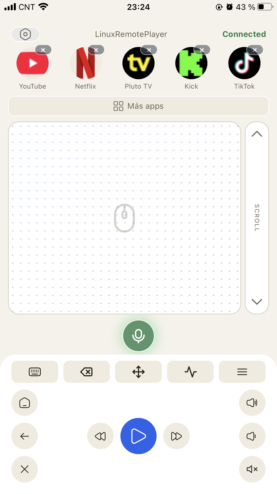

# LRP OS / LinuxRemotePlayer

**LRP OS 1.0.0** es una ISO Debian que convierte una PC en un centro de medios controlado desde
el teléfono. La PC arranca directo en el panel; el teléfono es el control (touchpad, teclado, apps
y búsqueda). Todo corre en la red local: **sin nube, sin cuentas, sin licencia y sin telemetría**.

LinuxRemotePlayer es software libre bajo **GNU GPL v3**.



## Requisitos

- x86_64 con UEFI. Secure Boot soportado vía shim.
- 8 GB de RAM recomendado.
- GPU integrada, o NVIDIA RTX 3060 12 GB como GPU certificada.
- TV o monitor y la PC junto al teléfono en la misma red local.
- Base del sistema: Debian 13 stable amd64 minimal, con la sesión Xorg/Openbox y Firefox ESR.

Otras configuraciones pueden funcionar, pero no están garantizadas.

## Descarga

Las versiones se publican en [GitHub Releases](https://github.com/Gusitir/LinuxRemotePlayer/releases/latest).
Cada release incluye la ISO y el archivo **SHA256SUMS** para verificar la descarga:

```bash
sha256sum -c SHA256SUMS
```

## Instalación

1. Grabá la ISO en un pendrive (Rufus, Ventoy o `dd`) y verificá la imagen.
2. Arrancá la PC desde el pendrive en modo UEFI y elegí **Instalar** en el menú de arranque.
3. Al terminar, la TV muestra el panel con un PIN y un QR. Escaneá el QR o escribí el PIN en el
   teléfono para emparejar.

El APK de Android llega en la próxima release; mientras tanto se usa la PWA desde Chrome
(⋮ → Instalar aplicación). En iPhone/iPad: Safari → Compartir → Añadir a pantalla de inicio.

## Compilar

El proyecto se compila en Debian 13 (o WSL Debian) y produce primero un paquete `.deb` y después
la ISO con `live-build`.

```bash
# 1. Paquete .deb
./scripts/build_deb.sh          # deja dist/linuxremoteplayer_<VERSION>_amd64.deb

# 2. ISO híbrida (BIOS/UEFI) con el .deb dentro
./scripts/debian/iso/build_iso.sh --deb dist/linuxremoteplayer_<VERSION>_amd64.deb
# opcional: --output dist/lrp-os_<VERSION>_amd64.iso
```

El build de la ISO exige un filesystem Linux nativo (no `/mnt/*`); usá `--dry-run` para validar la
configuración sin construir. Detalles en [docs/DEVELOPING.md](docs/DEVELOPING.md) y
[docs/DEPLOY.md](docs/DEPLOY.md).

## Estructura del repositorio

| Ruta | Qué contiene |
| --- | --- |
| `backend/` | Servicio FastAPI: API, WebSocket de control, audio, Bluetooth, CA local, kiosk. |
| `frontend/` | PWA sin build: control del teléfono y panel de estado de la TV. |
| `scripts/` | Instalación, empaquetado `.deb`, bootstrap Debian e ISO. |
| `scripts/debian/iso/` | Configuración de `live-build`, hook de chroot e instalador de la ISO. |
| `website/` | Sitio estático (ES/EN) desplegado en Vercel. |
| `tests/` | Pruebas por fase y contratos de seguridad/empaquetado. |
| `docs/` | Arquitectura, desarrollo y despliegue. |

## Estado

LRP OS 1.0.0 está en preparación de release: instalación por ISO, arranque al panel, pairing por
PIN/QR y control local completos. El APK de Android se publica en una release posterior.

## Documentación

- [Arquitectura](docs/ARCHITECTURE.md)
- [Desarrollo y tests](docs/DEVELOPING.md)
- [Despliegue de la web y releases](docs/DEPLOY.md)
- [Política de seguridad](SECURITY.md)

## Licencia

Copyright © 2026 Agustín (Gusitir) y contribuyentes.

LinuxRemotePlayer se distribuye bajo **GNU General Public License v3.0**. Ver
[LICENSE](LICENSE), los avisos en [NOTICE](NOTICE) y las licencias de terceros en
[THIRD_PARTY_LICENSES.md](THIRD_PARTY_LICENSES.md).

## Reportar bugs

Usá los [issues del repositorio](https://github.com/Gusitir/LinuxRemotePlayer/issues) con pasos
para reproducir, versión (`/VERSION`), distro y hardware. Para vulnerabilidades, seguí
[SECURITY.md](SECURITY.md) y no abras un issue público.
